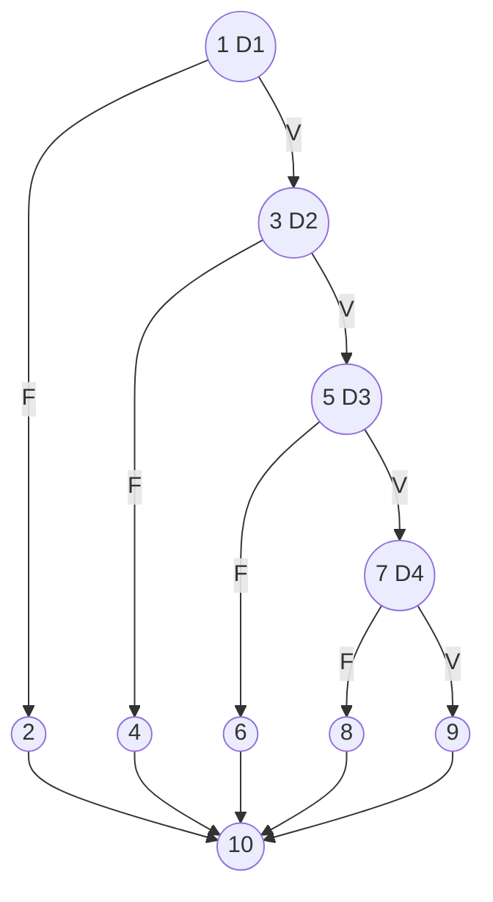

# Método del camino básico (Sesión 2)

Código: `backend/src/main/java/upeu/bibliotech_v2/service/PrestamoService.java` (los comentarios `// N#` indican el nodo del grafo).
Pruebas: `backend/src/test/java/upeu/bibliotech_v2/unitarias/CaminoBasico*Test.java` (un caso JUnit por camino).

## registrarPrestamo() · RN-03

| Nodo | Sentencias |
|---|---|
| 1 | buscar libro · **D1** ¿el libro existe? |
| 2 | lanzar 404 "El libro no existe" |
| 3 | **D2** ¿ejemplares > 0? |
| 4 | lanzar "El libro no tiene ejemplares disponibles" |
| 5 | buscar estudiante ACTIVO · **D3** ¿está ACTIVO? |
| 6 | lanzar "El estudiante no existe o no está ACTIVO" |
| 7 | contar préstamos activos · **D4** ¿menos de 3? |
| 8 | lanzar "El estudiante ya tiene 3 préstamos activos" |
| 9 | bajar un ejemplar, guardar libro, guardar préstamo ACTIVO |
| 10 | fin |

V(G) = E − N + 2 = 13 − 10 + 2 = **5** · = P + 1 = 4 + 1 = **5** · = regiones = **5**

| Camino | Recorrido | Datos de prueba | Resultado esperado | Prueba JUnit |
|---|---|---|---|---|
| C1 | 1→2→10 | libro 99 no existe | 404 "El libro no existe" | `c1_libroNoExiste` |
| C2 | 1→3→4→10 | libro con 0 ejemplares | rechazo sin ejemplares | `c2_sinEjemplares` |
| C3 | 1→3→5→6→10 | estudiante INACTIVO | rechazo estudiante | `c3_estudianteInactivo` |
| C4 | 1→3→5→7→8→10 | estudiante con 3 activos | rechazo límite | `c4_limiteDePrestamos` |
| C5 | 1→3→5→7→9→10 | libro 2 ejemplares, estudiante ACTIVO con 2 | préstamo ACTIVO, quedan 1 | `c5_prestamoExitoso` |

## devolverLibro() · RN-04

Decisiones deducidas de la regla: **D1** ¿el préstamo existe? · **D2** ¿está ACTIVO?

| Nodo | Sentencias |
|---|---|
| 1 | buscar préstamo · **D1** |
| 2 | lanzar 404 "El préstamo no existe" |
| 3 | **D2** ¿estado ACTIVO? |
| 4 | lanzar "El préstamo ya fue devuelto" |
| 5 | subir un ejemplar, estado DEVUELTO, guardar |
| 6 | fin |

V(G) = 7 − 6 + 2 = **3** · = 2 + 1 = **3**

| Camino | Recorrido | Datos | Resultado esperado | Prueba JUnit |
|---|---|---|---|---|
| C1 | 1→2→6 | préstamo 50 no existe | 404 | `c1_prestamoNoExiste` |
| C2 | 1→3→4→6 | préstamo DEVUELTO | rechazo, stock sin cambios | `c2_prestamoYaDevuelto` |
| C3 | 1→3→5→6 | préstamo ACTIVO, libro con 0 | DEVUELTO, libro con 1 (DISPONIBLE) | `c3_devolucionExitosa` |
